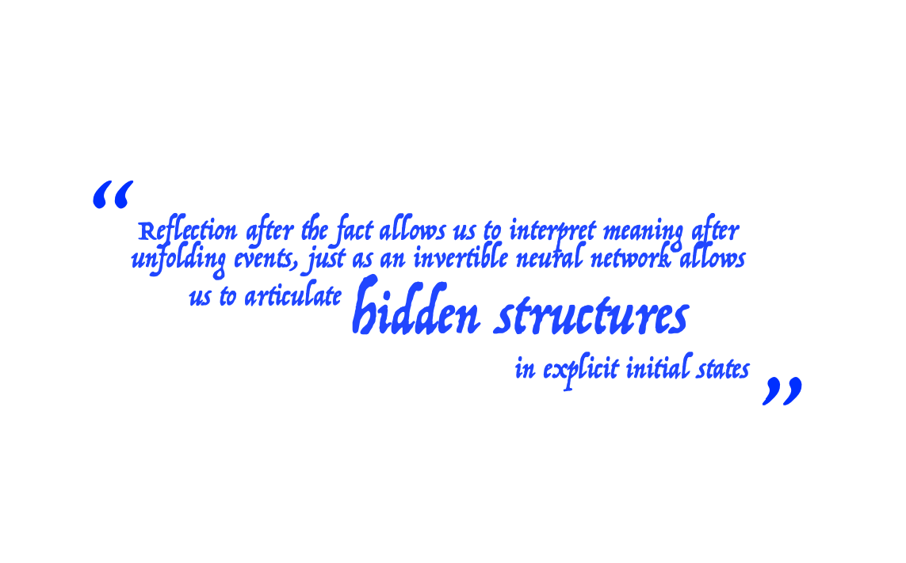
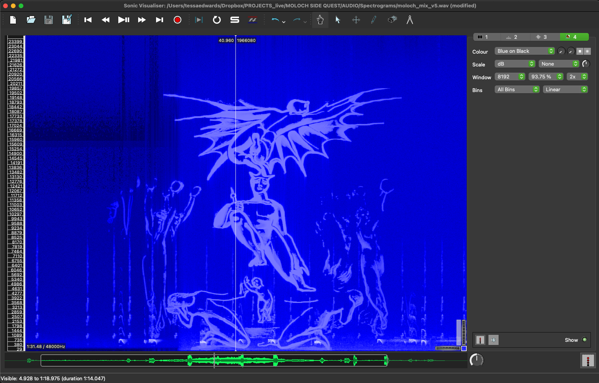
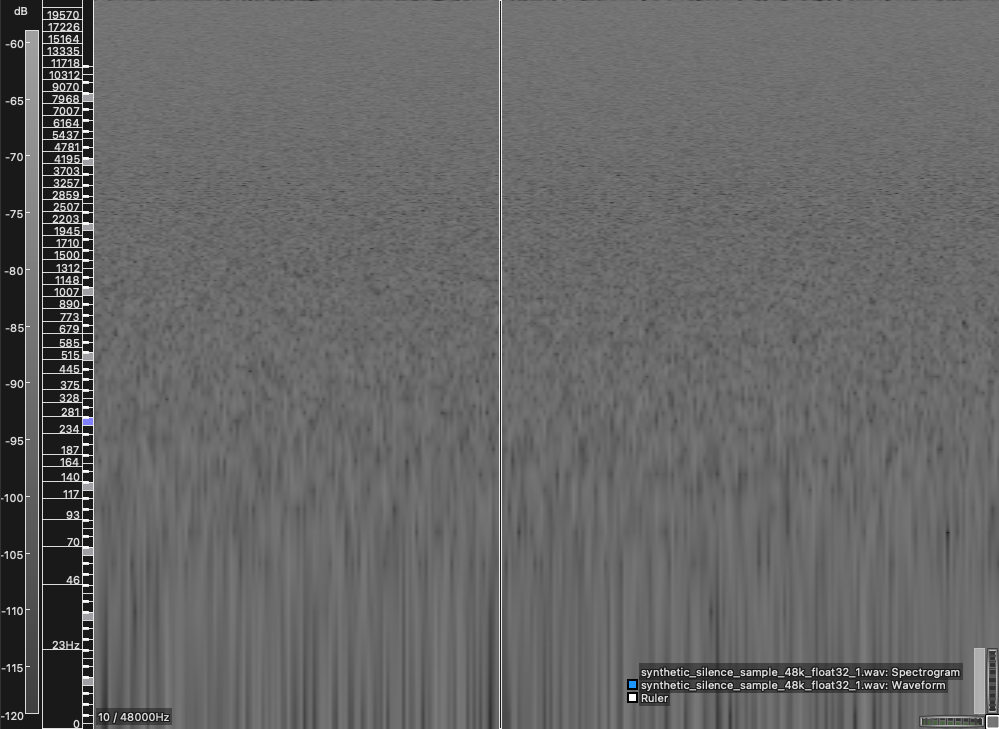
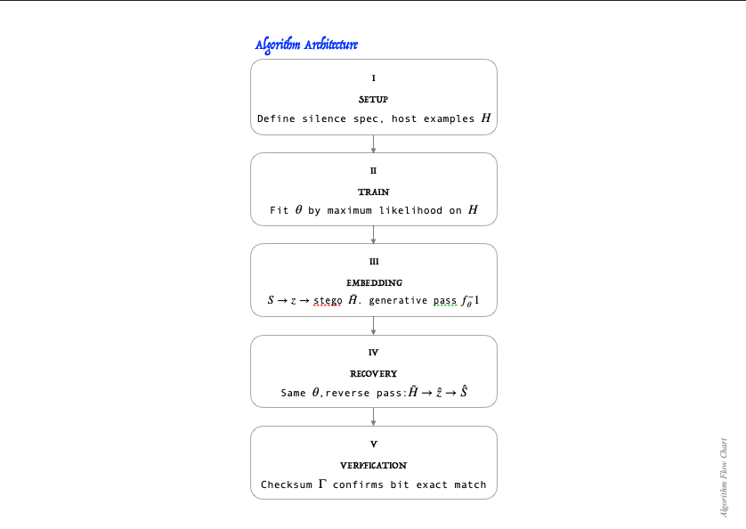
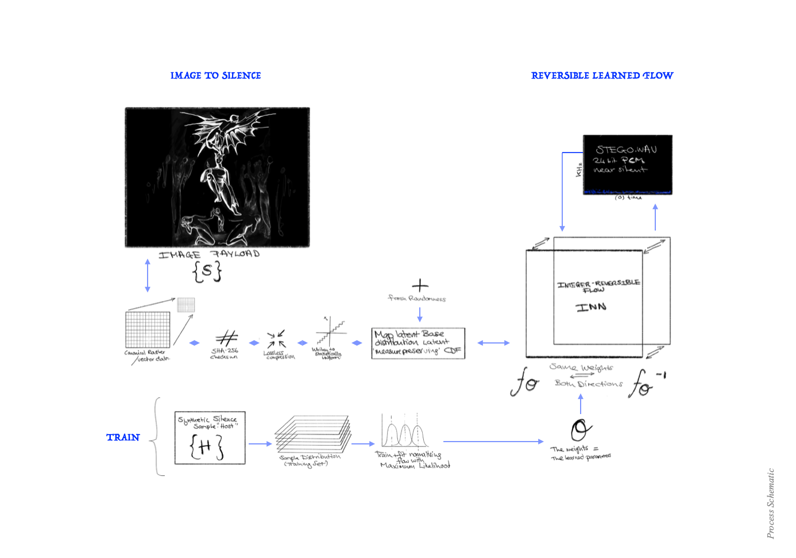
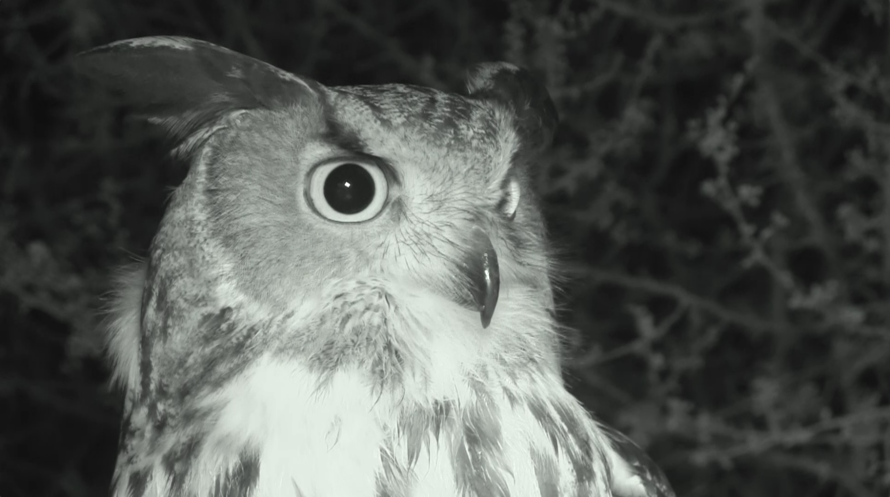

<h1 align="center">Athena Noctua</h1>

  

  <a href="docs/concept/PROJECT_CONCEPT.pdf"><b>Read the full concept (PDF)</b></a>

> " The owl of Minerva takes flight only at **dusk** "

**Work in progress.** Part I is complete and was presented live in London on 16/03/2026. Part II is specified and committed but not yet built. Part III, *Silent Signal*, is forthcoming.

---

## Abstract

  

  

**The project, Athena Noctua, presents an illustrative demonstration that validates the paradigm of applied anthropomorphism and biomimicry in Machine Learning and Artificial Intelligence architectures. It is a practical representation of the inherent dangers of adversarial manipulation in a latent dimension. Biomimicry in development, design and presentation undermines both the capabilities of AI systems, and the way we receive and evaluate them. The project exposes the potential for dominance over human perception.**

The project is made up of three parts; a video, live demonstration, and provisional algorithm, and is a complementary precursor to *Silent Signal* (forthcoming WIP). The audiovisual piece was accompanied by a live spectrogram analysis and discussion, presented before a live audience. To strengthen the thesis, the work has since evolved into a full exploration framework of time-domain signal hiding using an invertible Neural Network (INN).

| | | Status |
|---|---|---|
| **I** | LIVE AUDIOVISUAL PRESENTATION + SPECTROGRAM ANALYSIS | Complete |
| **II** | A REVERSIBLE NORMALISING FLOW-BASED MODEL + SYNTHETIC SILENCE SAMPLE | In progress |
| **III** | *Silent Signal* | Forthcoming |

---

## Part I

The short video presents a Giant Eagle Owl, a creature of thresholds, filmed in forest at night in infrared. Masked by the owl's calls and the ambient sound of the forest at night, a hidden signal is embedded into the darkness, beyond the scope of human hearing. Inspired by avian intelligence and communication in alternate frequency domains, a live ingest to a spectrogram reveals a secret message in the audio track. An image surfaces within the frequency heat-map; a William Blake illustration, *The Flight of Moloch*. The presentation literally puts the demon in demonstration.

*Flight of Moloch spectrogram capture, 'Blake's Moloch', in Sonic Visualiser.*

Reflection after the fact allows us to interpret meaning after unfolding events, just as an invertible neural network allows us to articulate hidden structures and explicit initial states. Steganography is the appropriate medium for illustration. From Greek *steganos* meaning covered, and *graphein* meaning writing, I refer to this method of concealing a hidden signal within a host signal.

The full narrative (the owl of Minerva, Hegel, Moloch) is in [`docs/concept/PROJECT_CONCEPT.md`](docs/concept/PROJECT_CONCEPT.md).

---

## On Synthetic Silence

The unique event of analogue silence holds a capacity and shape that bears very little congruence to synthetic silence. Synthetic silence is statistical authored emptiness, whose abstract resemblance is, rather, a mathematical description of absence. Maybe it is true silence in a sense because there is no subject of the experience, no physicality, no externality and no genuine origin. No entropy. Synthetic Silence a distribution proxy of an event.

This is the native condition of the digital dimension, and the project treats it as the material rather than a limitation.

**Sample statistics:**

I. Zero mean; no DC offset
II. Sign-symmetric distribution about zero (positive and negative sample values in equal measure)
III. Samples represent air-pressure deviation about the ambient level

---

## Part II

The second part of the project explores the capacity of truly 'hiding' the secret message within a generated synthetic noise floor. A method for signal hiding using a normalising flow-based model, intended to make the same payload genuinely concealed beyond the Human Auditory System (HAS) *and* spectrogram analysis within a generated audio statistically indistinguishable from an independent draw of the same declared distribution.

The proposed architecture is an integer-reversible generative steganographic system that frames payload hiding as constrained sample generation rather than traditional signal modification. At its core is an integer-reversible normalising flow trained by maximum likelihood to learn the distribution of a declared near-silent noise floor, yielding an exact bijection between the noise-floor domain and a simple latent space. Recovery applies the same flow in reverse to reconstruct the latent variables exactly, decode the embedded bitstream, and recover the original payload bit-for-bit, with integrity verified by checksum and spectrogram analysis. Since the mapping is integer-reversible and distribution preserving, every encoded output remains statistically indistinguishable from an ordinary sample of the learned silence distribution while permitting deterministic, lossless recovery without auxiliary side information; fresh encoder randomness ensures that repeated embeddings of the same payload always produce distinct valid silent carriers.

### Algorithm Architecture

| | Step | |
|---|---|---|
| **I** | SETUP | Define silence spec, host examples $H$ |
| **II** | TRAIN | Fit $\theta$ by maximum likelihood on $H$ |
| **III** | EMBEDDING | $S \rightarrow z \rightarrow$ stego $\tilde{H}$. Generative pass $f_\theta^{-1}$ |
| **IV** | RECOVERY | Same $\theta$, reverse pass: $\tilde{H} \rightarrow \hat{z} \rightarrow \hat{S}$ |
| **V** | VERIFICATION | Checksum $\Gamma$ confirms bit exact match |

Recovery works because $f_\theta$ and $f_\theta^{-1}$ are exact inverses under the same fixed weights, so no key or side channel is needed.

Full method: [`docs/method/`](docs/method/).

---

## Where it stands

| | |
|---|---|
| Part I | Complete. Presented live, Reference Point, London, 16/03/2026. |
| Phase 1 | Time-domain coupling INN. Failed for a documented architectural reason: 1-D time-domain convolutions could not move energy between the owl below 900 Hz and the secret near 15 kHz. Frozen at tag `phase1-coupling-inn-frozen`. Written up as [EXP-0001 to EXP-0004](experiments/). |
| Architecture | Committed: distribution-preserving cover synthesis through a fully learned integer-reversible flow, no key. ([`lab/DECISIONS.md`](lab/DECISIONS.md)) |
| Cover | Defined synthetic silence: zero-mean, sign-symmetric, about −80 dBFS RMS, 24-bit PCM. Spectral colour not yet declared. |
| Position | Gate R0 (specification). Next: R1, declare the spectrum and build the reference sampler; then R2, the synthetic oracle codec. ([`lab/PLAN.md`](lab/PLAN.md)) |
| Not yet built | The flow, the codec, the detector battery. |

The artefact is the lossless WAV. Video, screen recordings and live presentation are documentation and carry nothing: platform re-encoding destroys a payload held in exact sample values.

---

## Repository

| Path | |
|---|---|
| `docs/concept/` | Why the project exists; what synthetic silence is |
| `docs/method/` | Architecture, mathematics, algorithms, methodology, evaluation |
| `docs/related_work/` | What has already been done |
| `lab/STATE.md` | What is currently true |
| `lab/LOG.md` | What actually happened (append-only) |
| `lab/PLAN.md` | What happens next (gates R0–R7) |
| `lab/DECISIONS.md` | Why the major choices were made |
| `lab/IDEAS.md` | Every idea considered, F1–F38, and references |
| `lab/COLLAB.md` | How this was made with AI |
| `experiments/` | One folder per run, failures included |
| `src/athena/` | Code (Phase 1) |
| `media/` | Film stills, spectrograms, diagrams |

---

## With Thanks

Sadie and Norman the Owl, Feathers and Fur Falconry Center

Sophia, Reference Point, London
