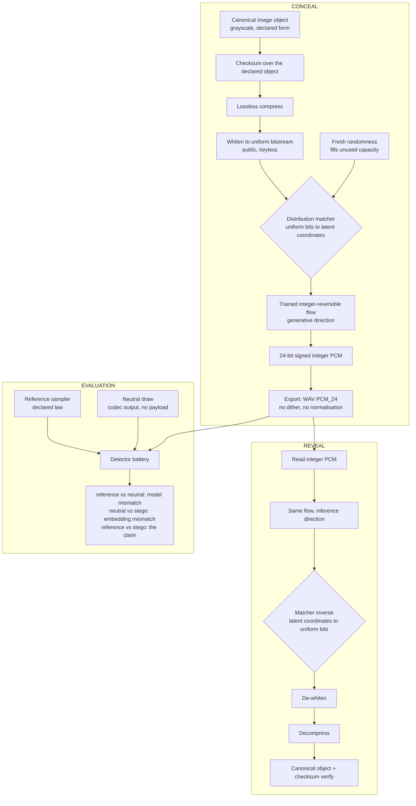

# ARCHITECTURE

Status: transcribed 29 July 2026 (LOG H-010) from the decisions recorded in LOG H-007 and H-008. Reconciled against `pipeline.mermaid` on 6 August 2026. Notation aligned with `FORMULATION.md` on 7 August 2026.

---

## System overview

The output file is not a recording with something hidden in it. It is a synthetic noise floor, generated from scratch, whose exact sample values were selected by the payload. A trained integer-reversible flow $f_\theta$ models the host law $P$, a declared silence distribution; running that flow in the generative direction turns a string of uniform bits into one valid draw of that distribution, and running it in the inference direction turns the draw back into the same bits. The host is that distribution rather than any particular file: the training draws $H^{(k)}$ and the output $\tilde{H}$ are instances of the same law, and the payload determines which instance. There is no cover file, no residual, no key, and nothing added on top of anything. The security claim is that the result is indistinguishable from an independent draw of the same declared distribution; the recovery claim is that the payload comes back bit-exact, verified by checksum.

## Components

| Component | Symbol | What it does | Ideas | Domain |
|---|---|---|---|---|
| Canonical payload object | $S$ | The declared, checksummed object to be carried — grayscale, single channel, declared as raster or vector | F5, F18 | bytes |
| Checksum | $\Gamma$ | SHA-256 over the declared object, appended | — | bytes |
| Lossless compression | $C$ | Reduces payload length before whitening. Public, keyless | — | bytes |
| Whitening | $W$ | Public, keyless mask making the bitstream uniform. Not secrecy — uniformity | F15 | bits |
| Distribution matcher | $\Phi$ | Measure-preserving map from uniform bits to coordinates under the model's conditional CDFs | F33 | bits ↔ latent |
| Fresh-randomness fill | $r$ | Fills unused capacity with genuine prior draws at conceal, so the same image gives a different file each run | F36 | latent |
| Integer-reversible flow | $f_\theta$ | The trained model. Its weights *are* the concealment map and the only reader | F29, F30, F20 | latent ↔ integer PCM |
| Export | — | Quantise once, write WAV PCM_24, no dither, no metadata dependence | — | file |
| Reference sampler | $P$ | Exact sampler for the declared law. Produces the null against which everything is tested | F32, F35 | integer PCM |
| Detector battery | — | Reference / neutral / stego comparisons; the measurement instrument, not just an adversary | F6, F31 | complex STFT, PCM |

Two directions of the flow: **inference direction** is data → latent (what maximum-likelihood training optimises); **generative direction** is latent → data (what conceal uses). Conceal runs it generatively; reveal runs it in inference. Both must be bit-exact, which is why the flow is integer-reversible rather than floating point.

## Pipeline



## Conceal, steps

$$b = W(C(\Gamma(S))), \qquad z = \Phi(b \Vert r), \qquad \tilde{H} = f_\theta^{-1}(z)$$

1. Take the canonical image object : grayscale, single channel, in the exact declared form (F5, F18). Compute the checksum over *that* object, not over a rendering of it.
2. Compress the checksummed object losslessly. The checksum is computed before compression and verifies the declared object, not the compressed stream.
3. Whiten the byte stream to uniform. This step is public and keyless; its purpose is that a uniform payload keeps the latent matching its prior, which is what keeps the output matching the floor.
4. Feed the uniform bits to the distribution matcher, which maps them onto latent coordinates under the model's conditional CDFs. Capacity not consumed by the payload is filled with genuine fresh prior draws (F36) never zero-padded, since zero-variance coordinates in a full-variance floor are an instant detector win.
5. Run the flow in the generative direction. Out come integer PCM samples.
6. Export once to WAV PCM_24. No dither, no normalisation, no limiter, no secondary chunks. The payload lives only in sample values.
7. Check with spectrogram that nothing shows up.

## Reveal, steps

$$\hat{z} = f_\theta(\tilde{H}), \qquad \hat{b} = \Phi^{-1}(\hat{z})\big|_{1:m}, \qquad \hat{S} = \Gamma^{-1}(C^{-1}(W^{-1}(\hat{b})))$$

Reveal is a deterministic decode from the file alone. It consumes no randomness — all the randomness was spent at conceal.

1. Read the integer PCM array from the WAV.
2. Run the flow in the inference direction to recover the latent coordinates exactly.
3. Invert the matcher to recover the uniform bitstream.
4. De-whiten.
5. Decompress.
6. Verify the checksum. It matches exactly, or the reveal has failed. There is no partial credit and no eyeballing the result.
````
````

## System Characteristics

| Property | Description | Ref |
|---|---|---|
| Output | Generated from scratch; payload selects the sample values | L13 |
| Files | One. Recovery needs the WAV and nothing else | L1 |
| Reader | The trained weights. No key; whitening is public | D-THESIS |
| Arithmetic | Integer on conceal and reveal. Floats train only | L14 |
| Carrier domain | Integer PCM. Complex STFT observes and critiques | L9, D-CARRIER |
| Security | Equality of distributions: the file is a draw of $P$ | D-ARCH |
| Repeat runs | Fresh randomness per run; same image, different file | F36 |

## Potential problems

- The declared law *is* the target, so embedding mismatch : the coding gap $\varepsilon_{\text{code}}$ — is approximately zero by construction once the matcher is measure-preserving over a uniform payload.
- The claim therefore rests on one quantity: how faithfully the trained flow reproduces the declared floor. That is the model gap $\varepsilon_{\text{model}}$, measurable as excess codelength or detector AUC above chance, and tested at R3 before any payload is folded in.

Residual risks, in order of concern:

| Risk | Note |
|---|---|
| Model mismatch | The whole claim reduces to it |
| Low-bit and ADC realism | Immaculate randomness across all 24 bits is itself detector bait (F34) |
| Finite-precision coding error | In the matcher |

## Frozen predecessor

Phase 1 was a 1-D time-domain coupling INN, frozen at git tag `phase1-coupling-inn-frozen`. It failed because 1-D time-domain convolutions could not relocate energy between the cover's sub-900 Hz content and the secret's ~15 kHz content (H-004). The conceal side was excellent — −75.9 dBFS — and the reveal side never moved. The current architecture avoids the problem by not being a relocation problem at all.

---

**Related documents.** The mathematics is in `FORMULATION.md`; the operational procedures in `ALGORITHMS.md`; what counts as success in `EVALUATION.md`; the gate ladder in `../../lab/PLAN.md`; the reasoning behind each committed choice in `../../lab/DECISIONS.md`.